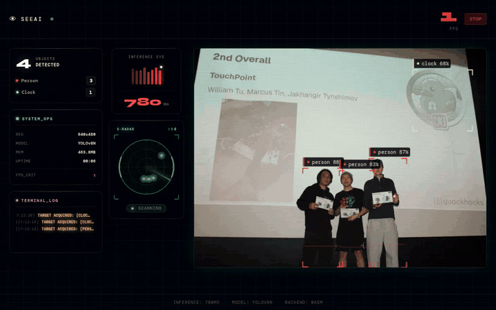
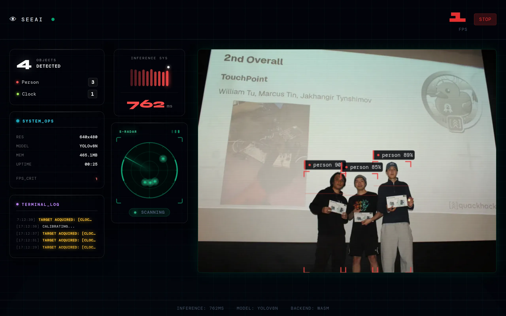

# SeeAI: object detection in the browser

Point a webcam at the room and YOLOv8n labels what it sees, running entirely in the browser tab through ONNX Runtime Web. There is no server and no API: the 12 MB model is downloaded once and every frame is processed on the device.



*Captured from the running app in headless Chromium. The camera is a fake device fed with a slow pan over a real photo, so the boxes follow people as the frame moves. The inference times shown (about 700 ms per frame) are from a shared 4-core server running the single-threaded WASM backend on CPU; a laptop is faster.*



## How a frame becomes boxes

The pipeline is in `src/utils/` and the loop in `src/pages/Index.tsx`.

1. **Load.** `loadModel()` streams `public/yolov8n.onnx` through a `ReadableStream` reader so the progress bar shows real bytes, then creates an ONNX Runtime session on the `wasm` execution provider (one thread).
2. **Capture.** The camera stream (640 x 480 requested) plays in a `<video>` element; each animation frame is drawn to an offscreen canvas.
3. **Preprocess.** The frame is resized to the model's 640 x 640 input and unpacked from RGBA bytes into a normalized `float32` tensor in planar CHW order, shape `[1, 3, 640, 640]`.
4. **Decode.** YOLOv8 returns `[1, 84, 8400]`: 8400 candidate boxes, each with `cx, cy, w, h` and 80 class scores. The output is stored attribute-major, so the decoder reads it in place with `data[(4 + c) * 8400 + i]` instead of transposing it. For each candidate it takes the best class, drops anything under 0.5 confidence, converts centre/size to corners, and scales x and y back to the video size separately.
5. **Non-maximum suppression.** `nms.ts` sorts by score and keeps a box only if no already-kept box of the same class overlaps it with IoU above 0.45. Class-aware NMS means a person holding a phone keeps both boxes.
6. **Draw.** `drawDetections.ts` paints corner brackets, a scan line and a label pill per box on a canvas laid over the video, plus a short flash and `+1` when a new class appears. The HUD panels read the same detection list.

## The HUD

Around the feed: FPS, inference time and its last ten values, per-class counts, a radar that plots each detection's position in the frame, resolution and memory, and an event log. The start screen has a WebGL shader background.


## Getting started

Prerequisites: Node.js 18 or later and npm.

```sh
git clone https://github.com/Jakhangir18/see-ai.git
cd see-ai
npm install
npm run dev
```

Open http://localhost:8080 and allow camera access when the browser asks. The dev server also sends `Cross-Origin-Opener-Policy` and `Cross-Origin-Embedder-Policy` headers (cross-origin isolation, which multi-threaded WASM needs; the app currently runs ONNX Runtime on one thread).

Production build:

```sh
npm run build      # output in dist/
npm run preview    # serve the build locally
```

`dist/` is a static site and can be served by any static host.

## Tech stack

| Tool | Purpose |
|---|---|
| [ONNX Runtime Web](https://onnxruntime.ai/) | In-browser model inference (WebAssembly) |
| [YOLOv8n](https://docs.ultralytics.com/models/yolov8/) | Object detection model (80 COCO classes), exported to ONNX |
| React 18 + TypeScript | UI |
| Vite 5 | Dev server and build |
| Tailwind CSS, shadcn/ui | Styling and UI primitives |
| Framer Motion | HUD animations |
| Three.js | Shader background on the start screen |

## Project structure

```
public/
  yolov8n.onnx            model loaded by the app
  ort-wasm-*.wasm         ONNX Runtime WebAssembly binaries
src/
  pages/Index.tsx         camera, detection loop, layout
  utils/
    detector.ts           model loading, preprocessing, inference, output decoding
    nms.ts                non-maximum suppression
    drawDetections.ts     box and label rendering
    cocoClasses.ts        the 80 COCO class names
  components/hud/         FPS, inference chart, detection breakdown, radar, system metrics, event log, startup sequence
  components/ui/          shadcn/ui components and visual effects
index.html
vite.config.ts
```
